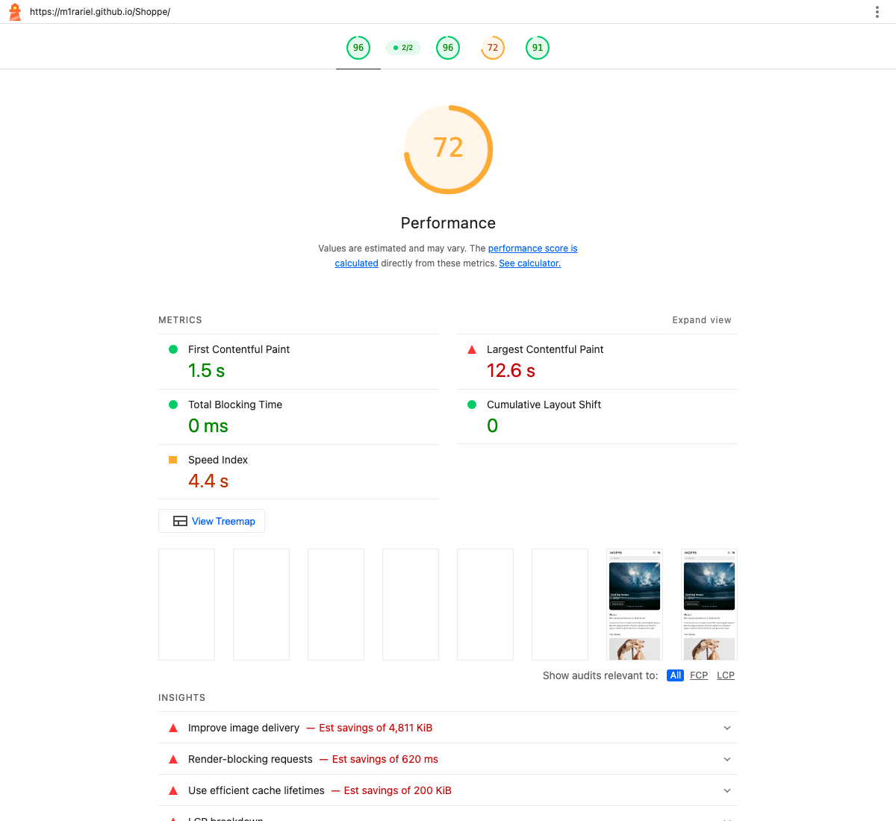
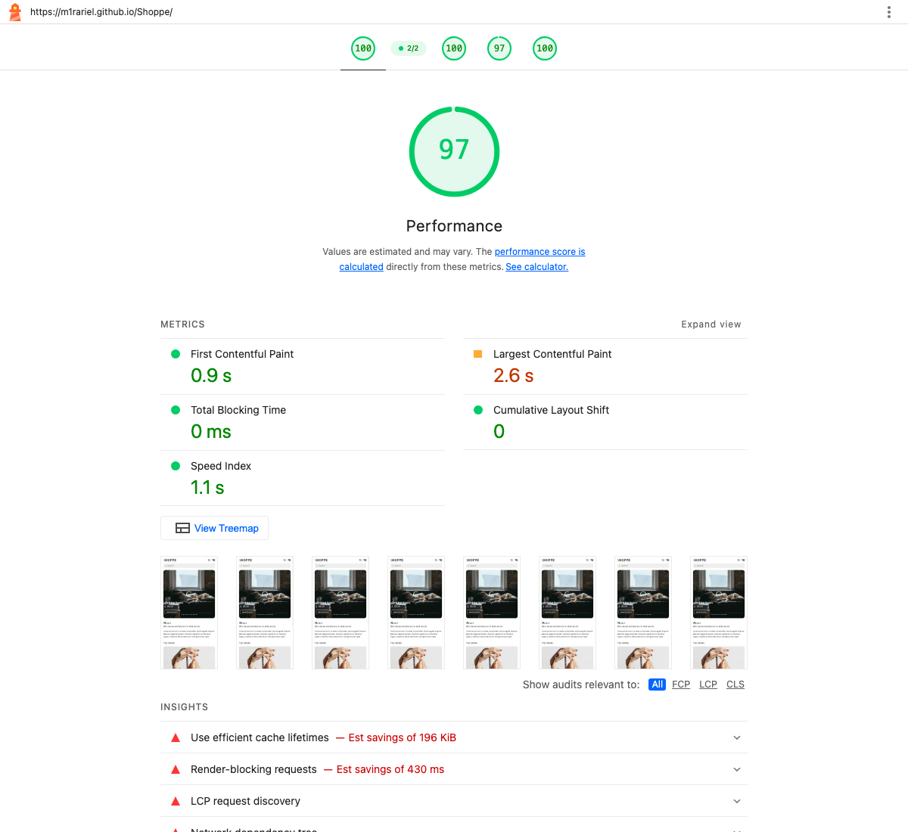
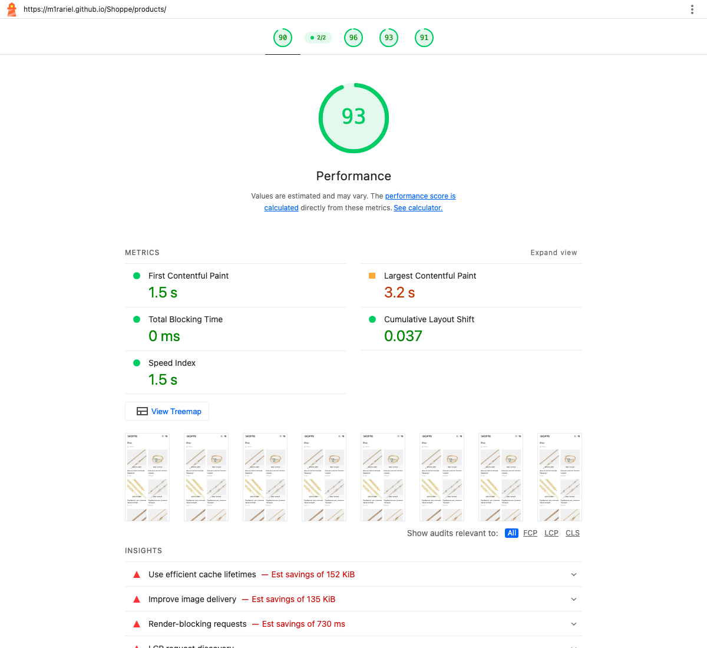
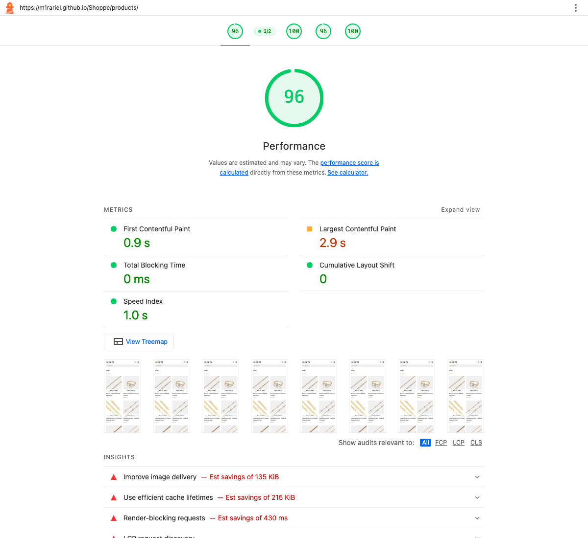
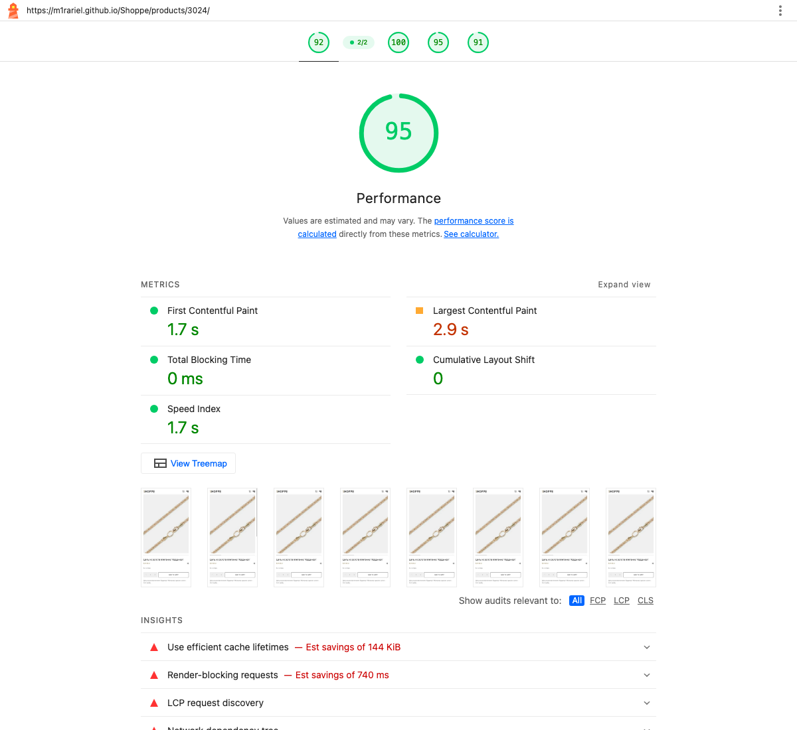
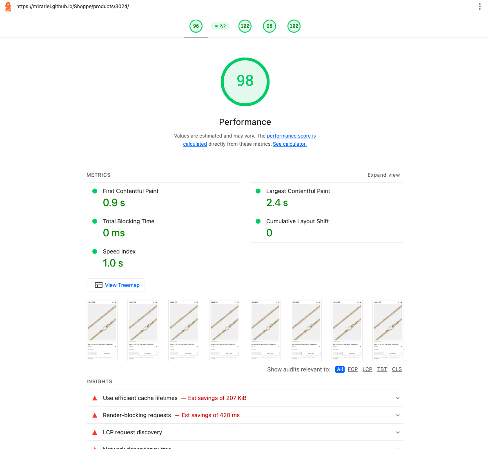

# Задание 12 — оптимизация производительности

## Методика

Production на GitHub Pages: <https://m1rariel.github.io/Shoppe/>.
Исходная версия — `c2306001f6bcd90b91e108dbf3639e6372baf1e4`.
Для каждой страницы и устройства сохранены три независимых запуска PageSpeed Insights;
сравниваем медианы. Повторные ссылки с одинаковым `fetchTime` не считаются новым запуском.
Все 18 исходных Lighthouse JSON из PSI сохранены в [pagespeed-before.zip](pagespeed-before.zip),
метрики, даты и ссылки — в [pagespeed-before.json](pagespeed-before.json).

| Страница                                                                                                                            | Mobile Performance до | Desktop Performance до | Mobile LCP до |
| ----------------------------------------------------------------------------------------------------------------------------------- | --------------------: | ---------------------: | ------------: |
| [Главная: исходный PSI](https://pagespeed.web.dev/analysis/https-m1rariel-github-io-Shoppe/yhmwbtthmp9c9vioa4x3uh)                  |                    72 |                     85 |       12,59 с |
| [Каталог: исходный PSI](https://pagespeed.web.dev/analysis/https-m1rariel-github-io-Shoppe-products/u67deeh5r5rixa4ifj1nbu)         |                    93 |                    100 |        3,17 с |
| [Товар 3024: исходный PSI](https://pagespeed.web.dev/analysis/https-m1rariel-github-io-Shoppe-products-3024/r5b1eu0x4xc282cxc2002t) |                    95 |                    100 |        2,86 с |

Оптимизированная версия `7bb6eb15ff86c81b489de254f6d6204c36f85f7c` опубликована
[успешным deploy](https://github.com/m1rariel/Shoppe/actions/runs/45836066785).
Проверка HTML подтвердила локальные шрифты, responsive picture и eager/high у первого слайда.

Итоговые результаты PSI: **три независимых запуска для каждой страницы и устройства до/после**.
Все реальные JSON после оптимизации, ссылки и `fetchTime` сохранены в
[pagespeed-after.json](pagespeed-after.json) и [pagespeed-after.zip](pagespeed-after.zip).
Кешированные повторы исключены из расчёта. Шесть отчётов ошибочных маршрутов
`/Shoppe/product/` и `/Shoppe/product/3024` измеряли HTTP 404 и также исключены.

| Страница                                                                                                               | Mobile Performance | Desktop Performance |         Mobile LCP |    Mobile FCP |        Mobile CLS |
| ---------------------------------------------------------------------------------------------------------------------- | -----------------: | ------------------: | -----------------: | ------------: | ----------------: |
| [Главная после](https://pagespeed.web.dev/analysis/https-m1rariel-github-io-Shoppe/ygb9t88ezq6i5ciaewdtun)             |        **72 → 97** |        **85 → 100** | **12,59 → 2,56 с** | 1,50 → 0,90 с |       0 → 0,00005 |
| [Каталог после](https://pagespeed.web.dev/analysis/https-m1rariel-github-io-Shoppe-products/495raxf7mm2n1d5edevar5)    |        **93 → 96** |       **100 → 100** |  **3,17 → 2,86 с** | 1,51 → 0,90 с | 0,03657 → 0,00005 |
| [Товар после](https://pagespeed.web.dev/analysis/https-m1rariel-github-io-Shoppe-products-3024/ql1hxukv7vfqbd7z73vg4j) |        **95 → 98** |       **100 → 100** |  **2,86 → 2,40 с** | 1,66 → 0,93 с | 0,00008 → 0,00008 |

Медиана mobile TBT — 0 мс на всех трёх страницах до/после.
Главная: transfer **5 718 826 → 376 541 байт (−93,4%)**, число запросов **41 → 28**.
Каталог: 503 564 → 500 340 байт, 40 → 38 запросов.
Товар: 492 070 → 488 787 байт, 34 → 32 запроса.
Это лабораторные измерения; CrUX для сайта не содержит достаточных полевых данных.
Performance 90+ достигнут на всех страницах. Мобильный LCP главной и каталога остаётся
чуть выше порога 2,5 с — зелёный общий балл не означает идеальные отдельные метрики.

Локальный Lighthouse не подменяет PSI: для главной в трёх локальных мобильных запусках
медиана Performance — 93, LCP — 3,21 с, transfer — 392 242 байта.
Локальные результаты не включены в сравнение «до/после» на GitHub Pages.

## Скриншоты PSI

Скриншоты ниже отрисованы официальным Lighthouse ReportGenerator из сохранённых PSI JSON.
Это представление реальных данных PSI, а не снимки интерфейса pagespeed.web.dev.
Для каждого изображения выбран отдельный запуск, ближайший к медиане Performance,
затем LCP. Отдельные значения на снимке могут отличаться от медиан таблицы.
Исходные отчёты и даты указаны в [screenshots/index.json](screenshots/index.json).

| Страница | До                                                   | После                                                  |
| -------- | ---------------------------------------------------- | ------------------------------------------------------ |
| Главная  |     |     |
| Каталог  |  |  |
| Товар    |    |    |

## Performance и Network

Для дополнительной проверки выполнено по три запуска Lighthouse CLI 13.6.0
на опубликованных страницах, Mobile и Desktop, до/после — всего 36.
Команда: `lighthouse <URL> --only-categories=performance --output=json --output=html`;
Desktop использует `--preset=desktop`, первый запуск каждой группы — `--save-assets`.
Браузер — Headless Chromium 159, PSI — Headless Chromium 157; эти две серии
сравниваются раздельно. Во время CLI-замеров сборки и тесты не запускались.
JSON и CDP Network logs — в [lighthouse-cli.zip](lighthouse-cli.zip),
медианы и самые тяжёлые ресурсы — в [lighthouse-cli.json](lighthouse-cli.json).

| Страница | CLI Mobile до → после | CLI Desktop до → после |
| -------- | --------------------: | ---------------------: |
| Главная  |               73 → 93 |                82 → 98 |
| Каталог  |               96 → 97 |               99 → 100 |
| Товар    |               97 → 98 |               99 → 100 |

[performance-traces.zip](performance-traces.zip) содержит реальные Chrome trace для
главной, каталога и товара (Mobile, первый запуск каждой группы, до/после).
Их можно распаковать и импортировать через **Chrome DevTools → Performance → Load profile**.
Архивы получены Lighthouse, ручная запись через интерфейс DevTools не выполнялась.
В CLI Network нет ответов HTTP ≥400; отменённый prefetch при переходе в исходной серии
не интерпретируется как ошибка API.

По трём мобильным PSI главной main-thread work — 262,14 → 230,86 мс,
JS bootup — 100,79 → 109,33 мс; длинных задач в этих запусках нет.
[cpu-analysis.json](cpu-analysis.json) фиксирует эти данные: главным ограничением были
изображения и загрузка ресурсов, а не блокировка main thread.
В исходной серии браузер повторно запрашивал Picsum `/v2/list` во всех трёх запусках;
после оптимизации таких клиентских запросов нет во всех трёх.

## Изменения

- Главная получает WebP и `srcset` с размерами под экран. Первый слайд загружается eager/high;
  соседи запрашиваются после его загрузки, остальные — при выборе. Все 10 слайдов,
  loop, pagination и исходные Picsum ID сохранены; fallback Unsplash обновляет обе ветки picture.
- Исправлено расхождение случайной страницы Picsum между статическим HTML и извлечённым
  payload при двойном prerender `/` и `/Shoppe/`. Выбор общий для одной сборки;
  обычный SSR/CSR сохраняет случайный выбор. Убрана повторная загрузка списка при hydration.
- DM Sans (normal/italic, variable) и Allerta Stencil размещены локально с `font-display: swap`.
  Лицензии и исходные URL находятся в `assets/fonts/`.
- Изображения About переведены в WebP: 279 932 → 14 238 байт и 81 431 → 7 100 байт;
  указаны размеры, lazy loading и async decoding.
- Первые шесть карточек каталога и первое изображение галереи загружаются без lazy-задержки.
  Для активного изображения галереи задан высокий приоритет.
- Путь каталога нормализован: `/products/` больше не скрывает поиск при hydration
  и не вызывает сдвиг разметки. Добавлены язык страницы и meta description.
- Удалён неиспользуемый модуль Swiper Navigation и его CSS.

## Nuxt Analyze

[nuxt-analyze.zip](nuxt-analyze.zip) содержит интерактивные `client.html`, `nitro.html` и
метаданные до/после. [bundle-analysis.json](bundle-analysis.json) — численные результаты.
После analyze выполнен обычный `nuxt generate`; анализирующая сборка не предназначена для деплоя.

Rendered size модулей Swiper: 85 376 → 81 169 байт, Navigation удалён (−4 207 байт).
Сумма rendered size всех клиентских модулей: 508 175 → 505 847 байт.
Это размеры модулей анализатора, а не сжатый сетевой transfer и не размер начальной страницы.
Основной выигрыш ожидается от изображений и порядка запросов.
Крупнейшие модули: Vue runtime-core 76 143 байта, Swiper core 65 629,
vee-validate 32 286. Формы уже находятся в отдельных чанках; новые зависимости не добавлены.

## Проверки

- `npm test`: 182/182.
- `npm run test:unit`: 67/67.
- ESLint, Stylelint, `tsc --noEmit`, Prettier и `git diff --check`: успешно.
- Production `NUXT_APP_BASE_URL=/Shoppe/ npm run generate`: 27 prerender routes.
  Проверка сгенерированного HTML/payload: один Picsum page, 10 фотографий.
- Chromium: ширины 320, 390, 767, 768 и 1440; 10 слайдов, loop, переходы pagination,
  отсутствие горизонтального overflow, каталог, галерея и fallback изображений.
  Поиск, фильтр, пагинация и возврат из товара проверены на desktop.
- На 390/1440 проверены открытие галереи, Escape/возврат фокуса, добавление/удаление
  товара из корзины и запрет гостевого checkout. Изменяющие HTTP-запросы подменялись
  синтетическими ответами; реальные оплаты и полный авторизованный checkout не выполнялись.
  Нажатие увеличения количества проверено без отдельного утверждения о числовой разнице.

## Ограничения и остаточные замечания

Случайные фотографии меняются между production-сборками: набор изображений до/после
может различаться. Поэтому снижение трафика отражает также различие самих фотографий;
эффект resize отдельно проверен на одном и том же Picsum ID.

GitHub Pages управляет cache headers и редиректами завершающего слеша.
Picsum перенаправляет изображения на свой CDN, что увеличивает LCP и может оставлять
замечание о discovery. У изображений API товаров параметры resize возвращают тот же
исходный JPEG; без серверной обработки такие URL не дают реального уменьшения.
Остаточный unused JavaScript включает Vue/Nuxt и используемый интерактивный Swiper.
Условие о полном закрытии 80–90% предупреждений не следует из зелёного балла:
часть замечаний исправлена частично, а замечания о cache, внешних изображениях,
render-blocking CSS и unused framework JavaScript остаются.
Фактическое сравнение каждого аудита и ограничения перечислены в [audit-comparison.json](audit-comparison.json);
заявление о закрытии 80–90% всех предупреждений не делается.
При строгом подсчёте полностью проходящих non-metric performance audits закрыты
2 из 8 исходных предупреждений главной, 0 из 6 каталога и 0 из 6 товара.
Частичные улучшения не засчитаны как полное закрытие; информативные аудиты и метрики
в знаменатель не входят. Для дальнейшего закрытия нужны отдельные решения по хостингу,
серверному resize изображений и более глубокой переработке загрузки клиентского кода.
